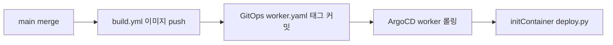

# PR 작성 컨벤션

이 문서는 Team-Neki-Workflow PR의 제목과 본문을 쓰는 기준을 다룹니다. 본문 구성은 Team-Neki-Server와 같습니다. 사람이 직접 쓸 때와 에이전트(Claude Code, Codex 등)에게 맡길 때 같은 기준을 씁니다. 에이전트에게 맡길 때는 마지막 절의 [PR 작성 프롬프트](#pr-작성-프롬프트)를 그대로 넘기면 됩니다.

## 제목

- 형식 : 커밋 규약과 같음. `{type}: 설명 (BACKEND-{번호})`
- type : `feat`, `fix`, `refactor`, `chore`, `docs`, `test`, `ci`
- 설명 : 머지 후 달라지는 동작을 한 줄로. 작업 과정("~ 작업", "~ 수정 1차")은 쓰지 않음

```text
feat: enriched location 에 GIST 인덱스를 건다 (BACKEND-250)
ci: PR 이 열릴 때 Discord 로 알린다 (BACKEND-245)
```

## 본문은 어떻게 구성하는가?

본문은 **배경 -> 변경 내용 -> 검증** 세 절로 씁니다. 틀은 `.github/PULL_REQUEST_TEMPLATE.md`에 있습니다. 리뷰어가 "왜 바꾸는가"를 먼저 이해해야 diff를 맥락 안에서 읽을 수 있기 때문에 배경을 맨 앞에 둡니다.

### 배경

- 무엇이 문제였고 왜 지금 고치는지를 2~4문장 산문으로 씀
- 문제의 영향(수집 누락, 잘못된 좌표, 배포 실패, 비용 등)을 한 문장 이상 포함
- Sprint 티켓 링크 한 줄 : `[BACKEND-123](https://sprint.suitestudy.com:4641/tasks/{티켓 id})`
- 티켓 설명을 복사하지 않음. 리뷰어가 티켓을 열지 않아도 이해되는 수준으로 요약
- 일부러 범위 밖으로 둔 것이 있으면 한 문장으로 밝힘

### 변경 내용

- 핵심 변경 3~5개를 불릿으로 씀. 파일·함수 목록이 아니라 동작이 어떻게 달라지는지를 씀
- 정책을 바꿨다면 고친 `docs/spec/` 문서를 함께 적음
- 리뷰어가 판단해야 할 설계 선택이 있으면 고른 쪽과 버린 대안을 한 줄로 병기
- 수집 대상 사이트나 외부 API의 함정을 피해 간 코드가 있으면 함정과 대응을 한 줄로 적음. 다음 사람이 모르면 같은 곳에 빠질 것만
- 흐름이 바뀌면 mermaid 다이어그램을 넣음 (아래 기준 참고)

### 검증

- 실제로 실행한 명령과 결과 (e.g. `make check` spec anchor 106개 일치, pytest 138개 통과·15개 skip)
- 실측하지 않은 수치와 돌리지 않은 검증은 쓰지 않음. "확인했습니다"만 적지 않음
- 확인하지 못한 것과 배포 후 확인할 것을 숨기지 않고 적음
- 머지 전에 누군가 해야 할 일이 있으면 `**머지 전 확인:**`으로 시작하는 한 줄을 마지막에 둠. 확인 없이 머지하면 무엇이 깨지는지를 함께 씀
- 스택 PR이면 base가 `main`이 아닌 이유를 같은 위치에 한 줄로 씀

## 얼마나 자세히 쓰는가?

PR 본문은 작업 일지가 아니라 리뷰 안내문입니다. diff를 읽으면 바로 보이는 내용은 본문에서 빼는 것이 좋습니다.

- 목표 길이 : 다이어그램을 빼고 한 화면(약 40줄) 이내
- 쓰지 않는 것
  - 커밋 순서대로 나열한 작업 과정
  - 변경 파일 전체 목록
  - 포맷팅, import 정리, 이름 변경 같은 부수 변경
  - 시도했다가 되돌린 내용 (결론에 영향을 줬다면 대안으로 한 줄만)
  - 실행 로그 전체 (결과 요약 줄만 옮김)

## mermaid는 언제 넣는가?

이 저장소의 PR은 flow·task 순서, Prefect deployment, 이미지 빌드와 GitOps 배포처럼 순서가 있는 변경이 대부분입니다. 흐름이 바뀌는 PR은 산문보다 다이어그램 하나가 빠르게 읽힙니다.

- 넣는 경우 : flow·task 순서, 단계 사이 데이터 이동(S3, Postgres, 색인), deployment·스케줄, CI/배포 workflow가 바뀔 때
- 넣지 않는 경우 : 흐름 변화 없이 한 지점만 고칠 때 (파서 수정, 설정값 변경, 문서 수정 등)
- 바뀐 구간만 그림. 노드는 10개 이내
- 순서가 중요하면 `sequenceDiagram`, 분기·단계가 중요하면 `flowchart`
- ASCII 그림은 쓰지 않음 (GitHub이 mermaid를 렌더링함)

배포 경로를 바꾼 PR이라면 다음 정도면 충분합니다.



## 문체

- 산문 : "~습니다"체
- 불릿 : 개조식 (명사형 종결, ~함/~음)
- 함수명, 설정 키, 명령어, 경로는 백틱으로 감쌈
- 이모지는 쓰지 않음 (도구가 본문 끝에 붙이는 attribution 줄은 예외)

## PR 작성 프롬프트

에이전트에게 PR 제목과 본문을 맡길 때 아래 블록을 그대로 프롬프트로 씁니다. `{base}`는 PR의 base 브랜치입니다.

```text
현재 브랜치의 PR 제목과 본문을 docs/conventions/pull-request.md 기준으로 작성한다.

입력
- git log --oneline origin/{base}..HEAD
- git diff origin/{base}...HEAD
- Sprint 티켓 (BACKEND-번호). 대화 맥락에 없으면 sprint MCP get_ticket 으로 조회한다.

제목
- 커밋 규약과 같게 {type}: 설명 (BACKEND-{번호}).
- 설명은 머지 후 달라지는 동작을 한 줄로 쓴다.

본문
- .github/PULL_REQUEST_TEMPLATE.md 의 세 절(배경, 변경 내용, 검증)만 쓰고 템플릿 주석은 지운다.
- 배경: 무엇이 문제였고 왜 지금 고치는지 2~4문장. 영향 한 문장 이상. 티켓 링크 한 줄. 일부러 범위 밖으로 둔 것이 있으면 한 문장.
- 변경 내용: 동작이 어떻게 달라지는지 3~5개 불릿. 파일 목록 금지. 고친 docs/spec 문서를 적는다. 설계 선택은 버린 대안과 함께 한 줄. 사이트·API 함정을 피한 코드가 있으면 함정과 대응 한 줄.
- 흐름(flow·task 순서, 단계 사이 데이터 이동, deployment·스케줄, CI/배포 workflow)이 바뀌면 바뀐 구간만 mermaid 로 그린다. 노드 10개 이내. 흐름 변화가 없으면 넣지 않는다.
- 검증: 실제로 실행한 명령과 결과 수치. 실측하지 않은 수치와 실행하지 않은 검증은 쓰지 않는다. 확인 못 한 것과 배포 후 확인할 것을 적는다.
- 머지 전에 할 일이 있으면 검증 끝에 "**머지 전 확인:**" 한 줄. 스택 PR 이면 base 가 main 이 아닌 이유도 한 줄.
- 다이어그램을 빼고 40줄 이내. 커밋별 작업 과정, 부수 변경(포맷팅, import, 이름 변경), 실행 로그 전체는 쓰지 않는다.
- 산문은 "~습니다"체, 불릿은 개조식. 이모지 금지 (도구가 붙이는 attribution 줄은 유지).
```
