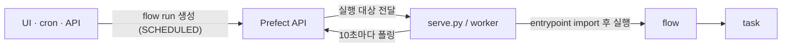
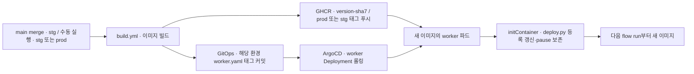

# Prefect 실행 모델

## 실행 모델

UI나 cron이 워크플로를 직접 실행하지 않습니다. flow run 레코드를 만들어둘 뿐이고,
`serve.py`나 worker가 API를 주기적으로 들여다보다 집어갑니다. pull 모델입니다.

여기서 따라오는 성질들이 있습니다.

- 실행 프로세스가 없으면 run이 `SCHEDULED`에 쌓임. 등록만으로는 실행되지 않음
- 버튼을 눌러도 최대 10초 지연이 있음 (`runner.poll_frequency`, `worker.query_seconds`)
- 서버가 워커에 접근할 필요 없음. 워커의 outbound만 열리면 됨
- task는 flow와 같은 프로세스에서 실행됨. `@task`는 재시도와 상태 추적 단위이지
  실행 격리 단위가 아님

**UI에서 실행하려면 deployment 등록과 실행 프로세스가 둘 다 필요합니다.** 하나만
있으면 UI에 보이지만 눌러도 진행되지 않거나, 아예 목록에 뜨지 않습니다.

### 운영 배포 파이프라인

Actions는 Prefect 서버에 접근하지 않습니다. 서버가 외부에 노출되어 있지 않기
때문입니다. 이미지를 밀고 GitOps 태그를 바꾸는 것까지만 하고, deployment 등록은
클러스터 안에서 일어납니다.

worker와 flow run(Job 파드)이 같은 이미지입니다. 이미지에 `WORKFLOW_IMAGE`로 자기
참조가 구워져 있고 `deploy.py`가 이를 `job_variables.image`에 넣습니다. 이게 없으면
flow run이 work pool 기본 이미지(베이스 prefect 이미지)로 떠서 `flows`를 찾지
못합니다.

- entrypoint가 cwd 기준 상대경로라 worker와 Job 모두 `/opt/prefect`에서 실행됨
- 파드는 uid 1001, 루트 파일시스템 읽기 전용일 수 있음. 이미지 경로에 쓰지 않고
  파일은 root 소유 644로 둠
- 자격증명은 GitOps의 k8s Secret `prefect-workflow`가 flow run Job 파드 환경변수로
  넣음 (`worker-base-job-template.json`의 envFrom). worker 파드가 아님. IAM role 없음.
  코드는 환경변수만 봄. 새 환경변수를 읽는 flow를 추가하면 GitOps의
  `workflow-secret.example.yaml`에 키를 같이 추가함
- `pyproject.toml`의 prefect 버전은 Dockerfile 베이스와 같아야 함. 다르면 uv.lock
  설치가 베이스의 prefect를 덮어써 prefect-kubernetes가 깨지고 worker가 뜨지 않음.
  `make image`가 버전을 assert함
- 매니페스트와 RBAC은 GitOps 레포 `overlays/prefect/`에 있음. 여기 두지 않음
- Prefect API 와 메타DB 는 공통. 기존 `prefect` worker/work pool/Job 은 prod,
  `prefect-stg` worker/`neki-stg-pool`/Job 은 staging. stg deployment 는 `-stg`
  접미사로 구분하고 처음에는 pause 상태로 등록함. 각 네임스페이스의
  `prefect-workflow` Secret 을 사용함.
  검색 색인 Batch Job 은 flow run 파드의 service account namespace 를 읽어 같은
  네임스페이스에 생성함.
  staging 설정은 GitOps `overlays/prefect-stg/` 에 있음
