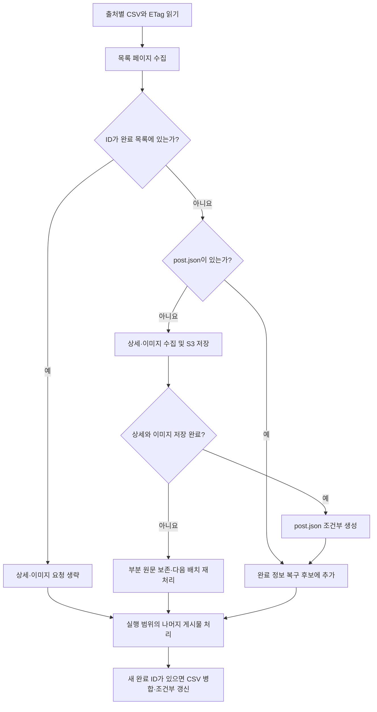

# 브랜드 소식 수집 완료 인덱스 LLD

## 1. 목적과 적용 범위

브랜드 소식 수집 완료 여부를 출처별 S3 CSV로 관리한다. 운영 RDB에 수집 상태 테이블을 추가하지 않고, 기존 S3 원문·이미지 보관 구조를 유지하면서 게시물별 완료 조회 요청을 줄인다.

- 관련 티켓: BACKEND-258
- 상위 설계: [브랜드 소식 HLD](https://sprint.suitestudy.com:4641/wiki/cmve1qomb005hka01j1l6xpm9)
- 현재 구현 계약: [브랜드 소식 수집 spec](../spec/events-collect.md)
- 문서 상태: **구현 반영**. CSV 완료 인덱스로 선별하고 미등록 ID만 `post.json`에서 복구한다. 실행 계약의 정본은 spec이며, 이 문서는 저장·갱신·복구 설계를 설명한다.

수집한 게시물은 원칙적으로 변경되지 않는다는 전제다. 완료된 게시물의 상세·이미지는 재요청하지 않으며 원문 수정·삭제를 자동 감지하지 않는다. 이 문서는 collect의 완료 판정과 복구만 다룬다. 완료 목록에 없다는 이유로 enrich나 사용자 공개를 차단하지 않는다. 확보한 이미지의 우선 공개와 누락분 재처리는 기존 정책을 유지한다.

## 2. 저장 구조와 식별자

```text
events/raw/<source_key>/
  collected.csv
  <external_id>/
    <JSON SHA-256>.json
    post.json
    images/
      <이미지 SHA-256>.<확장자>
```

| 항목 | 계약 |
|---|---|
| `source_key` | `photosignature-frames`, `harufilm-news`처럼 수집 출처 구분. 브랜드에 여러 게시판이 있으면 각각 분리 |
| `external_id` | 원문 게시물 ID 문자열. 포토시그니처 `wr_id`, 하루필름 `idx`. CSV가 관리하는 값은 브랜드 ID가 아닌 게시물 ID |
| `brand_code` | 원문 JSON에 보존하는 `tb_brand.code`(`Platform` 값). 출처 모듈 상수. 인덱스의 식별 키로 사용하지 않음 |
| `collected.csv` | 해당 출처에서 수집이 끝난 ID(완료·영구 실패)의 조회용 인덱스 |
| `post.json` | 해당 게시물의 상세 확인·이미지 저장 완료를 나타내는 최종 원문. CSV 복구 근거 |
| 해시 이름의 JSON | 수집 단계별 원문. 부분 수집 결과 포함. 파일 존재만으로 완료 판정하지 않음 |
| 이미지 | 실제 포맷 검증 후 jpg/png/webp/gif 확장자 부여. 게시물 내부에서 동일 바이너리 재사용 |

S3 게시물 경로는 ID로 고정한다. 다운로드 폴더의 `ID-제목` 표시는 별도이며 제목의 공백·탭·줄바꿈을 제거한다. 제목 변경이 S3 경로나 완료 판정에 영향을 주지 않는다.

### CSV 스키마

UTF-8, 헤더 포함, Content-Type은 `text/csv; charset=utf-8`. Python 표준 `csv` 모듈로 읽고 쓴다.

```csv
external_id,status,recorded_at
579,complete,2026-10-19T03:38:00Z
580,failed,2026-10-19T03:39:00Z
```

| 컬럼 | 타입 | NULL | 의미 |
|---|---|---|---|
| `external_id` | 문자열 | 불가 | 해당 출처 내 게시물 고유 ID. 숫자형으로 변환하지 않음 |
| `status` | 문자열 | 불가 | `complete`(완료 원문 저장) 또는 `failed`(영구 실패) |
| `recorded_at` | UTC ISO 8601 문자열 | 불가 | `complete`는 `post.json`의 S3 LastModified, `failed`는 영구 실패 판정 시각. 원문 게시일·관측 시각과 구분 |

동일 ID는 한 행만 유지한다. 기존 ID의 상태와 시각은 재실행 시 변경하지 않는다. 읽을 때는 헤더만 검사하고 행 단위 검증은 하지 않는다. CSV를 쓰는 경로는 병합 task 하나뿐이라 손 편집이 아니면 형식이 어긋나지 않는다. CSV를 직렬화할 때 ID 문자열 순서로 정렬해 출력 순서를 고정한다. 재시도 횟수·에러 로그·flow 상태·실행 메트릭은 CSV에 넣지 않고 Prefect로 관리한다.

## 3. 배치 처리 흐름



1. 출처별 CSV를 한 번 읽고 `external_id -> (status, recorded_at)` 딕셔너리와 ETag를 메모리에 보관한다. ID 포함 여부 판정에 딕셔너리 키를 사용한다. 이미지와 원문 본문은 이 인덱스에 올리지 않는다.
2. 기존 `pages`, `max_posts` 범위 안에서 목록을 수집하고 ID 중복을 제거한다. 완료 ID를 발견했다고 페이지 순회를 조기 종료하지 않는다.
3. 인덱스에 있는 ID는 S3 게시물 조회와 외부 상세·이미지 요청을 모두 생략한다.
4. 인덱스에 없는 ID만 `post.json`을 조회한다. 유효한 완료 원문이 있으면 외부 요청 없이 복구 후보로 추가한다.
5. 완료 원문도 없으면 기존 collect를 실행한다. 원문과 이미지 저장이 모두 성공한 뒤 `post.json`을 생성하고 완료 후보로 추가한다.
6. 정상적인 배치 종료 시 신규·복구 후보를 인덱스에 병합한다. 새 ID가 없으면 PUT을 생략한다. 이미지 누락 등 게시물 단위 실패는 완료 후보에 넣지 않는다.
7. 인덱스 갱신까지 성공해야 해당 배치의 완료 기록 처리가 성공한 것으로 판단한다. 배치 중단으로 갱신하지 못한 후보는 다음 실행에서 복구한다.

`persist=False`는 CSV와 완료 원문을 조회·저장하지 않고 기존 다운로드·검증 경로를 사용한다.

### 수집 완료 조건

- 상세 본문 확인 성공
- `image_list_complete`가 `true`
- 발견한 이미지 모두 검증·S3 저장 성공
- 이미지 참조를 담은 `post.json` 저장 성공

본문을 정상 확인했고 이미지가 실제로 0장이면 완료 가능하다. 알 수 없는 이미지 주소, 상세 요청 실패, 이미지 저장 실패는 미완료다. 확보 이미지의 요청 생략까지는 이번 변경 범위에 포함하지 않는다.

### 영구 실패

미완료 게시물은 실패 원인에 따라 다르게 다룬다.

| 원인 | 분류 | 다음 실행 |
|---|---|---|
| `data:`·빈 이미지 주소, 이미지 HTTP 4xx, 파일 검증·크기·허용 호스트 실패 | 영구 | CSV에 `failed`로 기록하고 생략 |
| 상세 요청 실패, 이미지 5xx·네트워크 오류 | 재시도 | 상세와 이미지를 다시 처리 |

상세를 확인했고 남은 실패가 모두 영구 원인일 때만 `failed`로 기록한다. 재시도 원인이 하나라도 있으면 미완료로 두어 다음 실행에서 다시 수집한다. 같은 원인으로 매 실행 상세·이미지를 다시 받고 단계별 원문을 쌓는 것을 막기 위해서다. 401/403/429와 로그인·challenge는 게시물 실패가 아니라 출처 중단이다. flow 반환값의 `reasons`에 미완료·영구 실패 ID별 사유를 담는다. `failed` 게시물을 다시 수집하려면 CSV에서 해당 행을 지운다. 확보한 이미지가 있는 `failed` 게시물도 enrich 입력 원문 선택 규칙에 따라 공개 대상이 될 수 있다.

## 4. CSV 갱신과 동시 실행

행 단위 upsert가 아닌 **ID 기준 병합 후 CSV 객체 전체 교체**다. 기존 목록을 유지하면서 이번 실행에서 완료된 ID만 추가한다.

| 상황 | 저장 조건 | 처리 |
|---|---|---|
| CSV가 없음 | `If-None-Match: *` | 최초 생성. 다른 실행이 먼저 만들면 최신 파일을 읽고 병합 |
| CSV가 있음 | `If-Match: <읽은 ETag>` | 읽은 버전이 그대로일 때만 전체 교체 |
| 조건 충돌 | 최신 CSV·ETag 재조회 | 최신 목록과 이번 실행의 완료 후보를 합쳐 다시 조건부 저장 |
| 후보가 이미 모두 반영됨 | 저장 불필요 | 성공으로 종료 |
| 접근 거부·CSV 헤더 불일치 | 저장 금지 | 빈 목록으로 대체하지 않고 실패 처리 |

ETag는 S3 객체 갱신 조건에 사용하는 불투명한 값으로 취급한다. 이미지 SHA-256과 혼동하거나 파일 내용의 MD5라고 가정하지 않는다.

병합 task는 매 시도마다 최신 CSV를 다시 읽고 조건부 저장한다. 같은 낡은 ETag로 PUT만 반복하지 않는다. 충돌 및 일시 오류의 재시도는 Prefect task에 맡기고 유한 횟수로 제한한다. 초기 값은 기존 S3 task와 같은 재시도 3회, 지연 2·5·10초를 사용한다. 파싱·스키마 오류와 권한 오류는 자동 재시도 대상에서 제외한다.

두 실행이 같은 신규 ID를 동시에 발견하면 외부 수집 자체는 중복될 수 있다. 조건부 저장은 파일 덮어쓰기와 완료 기록 유실을 방지하며 외부 요청의 정확히 한 번 실행을 보장하지 않는다. 필요 시 Prefect에서 출처별 실행 동시성을 제한하고, 수동 직접 실행까지의 적용 범위는 별도 확인한다.

## 5. 트랜잭션 경계와 복구

S3의 단일 객체 교체와 이미지·원문·CSV 여러 객체의 일괄 저장을 구분한다. 후자는 하나의 트랜잭션으로 처리하지 않으며 **이미지·원문 → post.json → CSV** 순서와 재실행 복구로 정합성을 유지한다.

| 실패 위치 | 남는 상태 | 다음 실행의 처리 |
|---|---|---|
| 상세·이미지 수집 도중 | 부분 원문·일부 이미지, CSV에는 없음 | 상세·이미지 재수집. 이미 저장된 동일 키는 재사용 |
| `post.json` 저장 실패 | 이미지와 단계별 원문만 존재 | 미완료로 판단. 재수집 후 완료 원문 생성 |
| `post.json` 저장 후 CSV 갱신 전 중단 | 완료 원문 존재, CSV에는 없음 | CSV에 없는 ID의 완료 원문을 읽고 인덱스 복구. 외부 재요청 없음 |
| CSV PUT 성공 후 응답 유실 | 반영 여부를 호출자가 모름 | 최신 CSV를 읽어 이미 반영됐으면 성공 처리 |
| CSV 갱신 충돌·일시 장애 | 다른 실행의 목록 또는 이전 목록 유지 | Prefect 재시도에서 최신 목록과 병합. 소진 시 flow 실패 |
| CSV 객체 없음 | 완료 목록을 모름 | 빈 인덱스로 시작하되 발견한 ID마다 완료 원문을 확인해 점진 복구 |
| CSV 헤더 불일치·접근 실패 | 신뢰할 수 없는 인덱스 | 수집을 시작하지 않고 실패 처리. 운영자가 완료 원문으로 재구축 |
| CSV에 있는 게시물의 원문·이미지가 수동 삭제됨 | 완료 목록과 실제 객체 불일치 | 정상 배치는 자동 검출하지 않음. 해당 ID의 인덱스·완료 원문을 함께 정리한 후 재수집 |

완료 원문 최초 생성에는 기존 `If-None-Match: *`를 유지한다. 다른 실행이 먼저 저장했다면 저장된 승자의 원문 식별자를 확인하고 그 객체의 LastModified를 완료 시각으로 사용한다. 다른 실행이 저장한 파일을 현재 실행의 메모리 내용으로 덮어쓰지 않는다.

인덱스의 정상 입력에서는 `post.json`의 source_key·external_id·brand_code와 요청이 일치하는지 확인한다. 완료 조건은 `post.json`을 쓰기 전에 확인하므로 읽을 때 다시 검사하지 않는다. `NoSuchKey`만 미존재로 취급한다. 버킷 부재·권한 오류·JSON 파싱 실패를 신규 게시물로 간주하지 않는다.

Retention이나 수동 삭제 시 원문·이미지·완료 기록의 관계를 함께 관리해야 한다. 이번 설계에는 자동 만료 삭제를 추가하지 않는다. 기존 객체를 정리하는 정책과 강제 재수집 인터페이스는 후속 범위다.

## 6. 요청량과 메모리

| 항목 | 정상 배치 기준 |
|---|---|
| 완료 목록 로딩 | 출처별 CSV GET 1회 |
| 완료 원문 조회 | CSV에 없는 발견 ID에 한해 GET |
| CSV 갱신 | 신규·복구 ID가 있으면 병합 시 최신 GET 1회 + 조건부 PUT 1회. 충돌·재시도 시 추가 |
| 외부 상세·이미지 요청 | CSV에도 완료 원문에도 없는 게시물만 수행 |
| 메모리 | 출처의 전체 완료 ID·시각과 이번 실행 후보 유지. 건수에 비례 |

소규모 콜라보 게시물 수집에서는 전체 CSV를 읽는 방식으로 시작한다. 새 CSV 작성 시 문자열 버퍼도 메모리를 사용하므로 ID 개수만으로 메모리 사용량을 계산하지 않는다. 브랜드별 파일 크기와 처리 시간이 부담될 때 분할을 검토한다.

## 7. 구현 위치와 전환

| 대상 | 구현 역할 |
|---|---|
| `events/common/storage.py` | CSV 읽기·검증과 조건부 병합 task 추가. 완료 원문 조회에서 복구용 완료 정보 제공 |
| `events/common/web.py` | 배치 시작 시 인덱스 로딩. ID 선별 후 완료 원문 복구 또는 신규 수집. 배치 종료 시 병합 호출 |
| 브랜드별 collect flow | 기존 파서와 수집 범위 유지. 공통 collect 변경 적용 |
| flow 반환값 | 기존 전체 `CollectedPost` 목록 대신 발견·생략·신규 완료·복구·미완료 건수 요약으로 변경. 생략한 게시물 반환을 위한 JSON GET 제거 |
| `tests/test_events_collect.py` | 완료 ID 생략, 복구, CSV 충돌 및 중간 실패 검증 추가 |
| spec·README | 구현과 같은 변경에서 실행·저장 계약 갱신 |

추가 DB나 별도 서비스는 도입하지 않는다. 기존 S3 클라이언트와 표준 CSV 기능을 사용한다. flow 반환값을 바꿀 때 호출 스크립트와 테스트를 함께 갱신한다.

현재 LocalStack에는 게시물별 완료 원문이 있으므로 CSV가 없는 첫 실행에서도 외부 상세·이미지를 재수집할 필요가 없다. 이번 목록에서 발견한 완료 원문으로 CSV를 생성한다. 목록 범위 밖 게시물은 나중에 발견될 때 복구하며, 전체 이력을 미리 나열하는 마이그레이션은 필수가 아니다.

## 8. 검증할 불변 조건

- CSV의 `complete` 행은 유효한 완료 원문 저장 이후에, `failed` 행은 영구 원인만 남았다고 판정한 이후에 추가.
- 부분 수집과 알 수 없는 이미지 목록은 완료로 처리하지 않음. 재시도 원인이 남은 게시물은 `failed`로 기록하지 않음.
- 인덱스에 있는 ID는 상세·이미지·완료 원문 조회를 모두 생략.
- 목록에 새 ID가 추가되면 기존 완료 ID를 유지하면서 신규 ID만 추가.
- 두 실행이 서로 다른 ID를 완료해도 최종 CSV에 두 ID 모두 유지.
- 완료 원문 저장 후 중단된 실행은 다음 실행에서 외부 재요청 없이 복구.
- CSV 접근·파싱 오류를 빈 목록으로 바꿔 전체 재수집하지 않음.
- 정상적인 미변경 배치에서는 CSV PUT이 발생하지 않음.
- 조건부 갱신의 충돌·응답 유실·재시도 소진을 구분해 테스트.
- LocalStack 통합 검증에서 첫 실행 후 같은 목록 재실행 시 외부 목록 요청만 발생하는지 확인.
- S3 교체 시 동시 갱신 지원을 포함한 조건부 쓰기 동작을 검증. LocalStack 결과만으로 운영 AWS 권한 구성을 검증했다고 간주하지 않음.

S3 조건부 쓰기 동작은 [AWS 공식 문서](https://docs.aws.amazon.com/AmazonS3/latest/userguide/conditional-writes.html)를 따른다.

## 9. 구현 검증 결과

2026-10-19 로컬 검증. 운영 AWS·RDB에는 접근하지 않았다.

- `make check`: 124 passed, 14 skipped. spec anchor 103개 일치, deployment 20개 로드.
- LocalStack 최초 CSV 생성: 기존 포토시그니처 완료 원문 12건에서 복구. 외부 상세·이미지 요청 없음.
- 동일 목록 재실행: CSV GET 1회, 외부 목록 요청 1회. 완료 원문 GET·CSV PUT·외부 상세·이미지 요청 없음.
- CSV에서 ID 580 한 행 누락 후 실행: 기존 11건 생략, 완료 원문 1건 조회로 복구. CSV는 검증 후 전체 12건으로 복원.
- 실제 LocalStack에서 낡은 ETag의 If-Match 및 기존 객체의 If-None-Match 거부 확인.
- 단위 테스트에서 동시 갱신 병합, PUT 응답 유실 후 중복 쓰기 방지, CSV 손상·권한 오류, 재시도 분류 검증.
